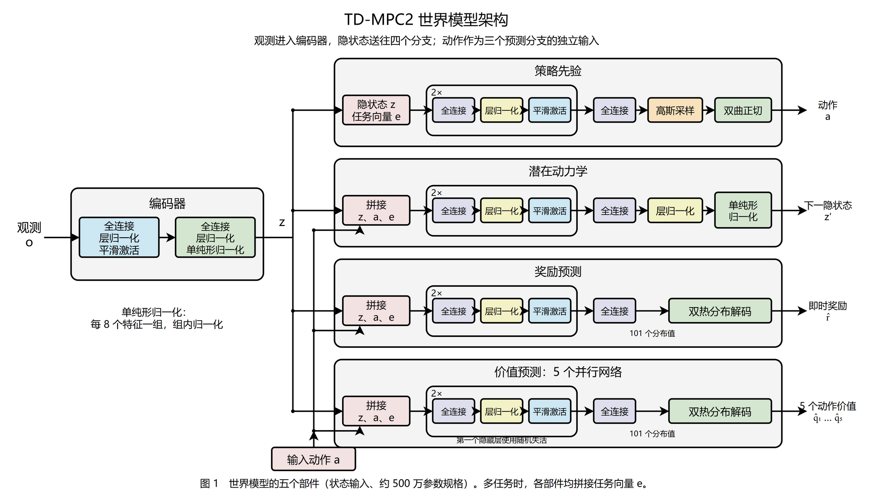
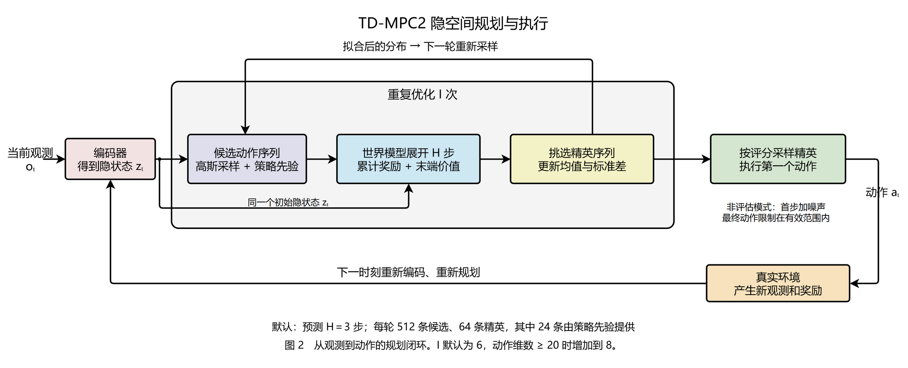
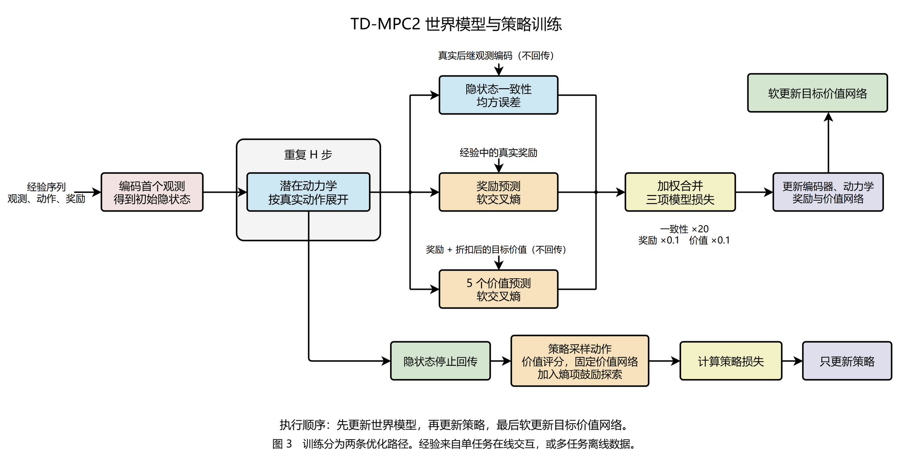
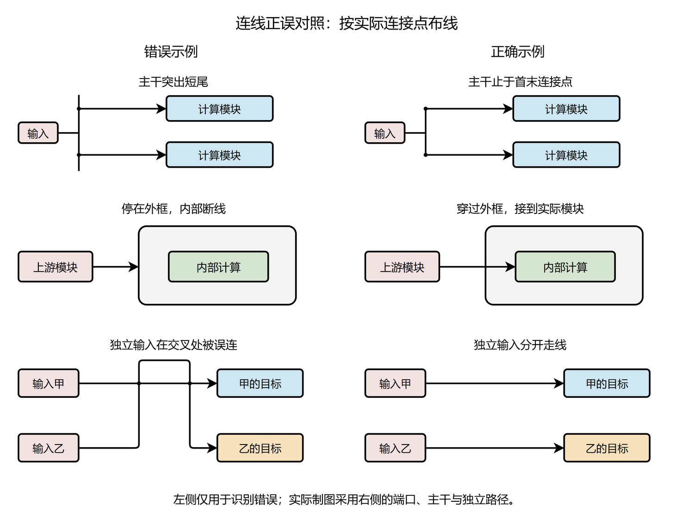

# 中文横向 draw.io 示例

制作或更新图前，实际查看以下三张标准预览与连线正误图；需要复用原生样式、分组或端口时打开对应 `.drawio`。规则以 [Drawio 制图约定](../Drawio制图约定.md) 为准。

本例根据公开的 TD-MPC2 方法代码重绘，采用用户指定的 Transformer 经典架构配图视觉语言，再改为中文横向布局。它是通用制图资源，不是当前任务的论文成果、理解记录或复现实验结果；不包含个人工作区、论文附件或账号数据。

## 标准示例

三页可编辑源文件：[中文横向样式.drawio](中文横向样式.drawio)。其中为原生节点、文字、连接器与嵌套分组；复制到新的任务图后再按目标代码改内容，保留该示例原件。

| 页 | 实际查看的预览 | 参考内容 |
|---|---|---|
| 1 模型架构 | [模型架构](模型架构.png) | 横向模块、并行分支、独立条件输入、重复层及组件嵌套 |
| 2 规划执行 | [规划执行](规划执行.png) | 横向主线、分布迭代、初始隐状态旁路、外围环境反馈 |
| 3 模型训练 | [模型训练](模型训练.png) | 预测与目标分开、损失汇合、独立优化路径与停止梯度 |

架构页仅展示状态输入、约 500 万参数规格的网络组成；任务向量只在多任务时使用。图内三页、五个部件、并行网络数量、规划步数与损失权重属于该例，不能成为其他论文的默认结构或参数。此处的流程图是样式与分层示范；实际任务还需核对所选实验入口、配置、数据处理、验证和权重等适用路径，由主图与子图共同覆盖。

## 连线错误对照

源文件：[连线正误.drawio](连线正误.drawio)。实际查看 [连线正误预览](连线正误.png)，制作时采用右侧的正确画法。

- 主干准确止于首末连接点，清除突出短尾。
- 连线穿过仅表示范围的外框后，继续接到内部真实模块。
- 独立输入分开走线；交叉处的连接点必须符合实际语义。

错误一侧故意保留反例，只用于识别问题；不能把它作为通过验收的输出或复制其线路。
